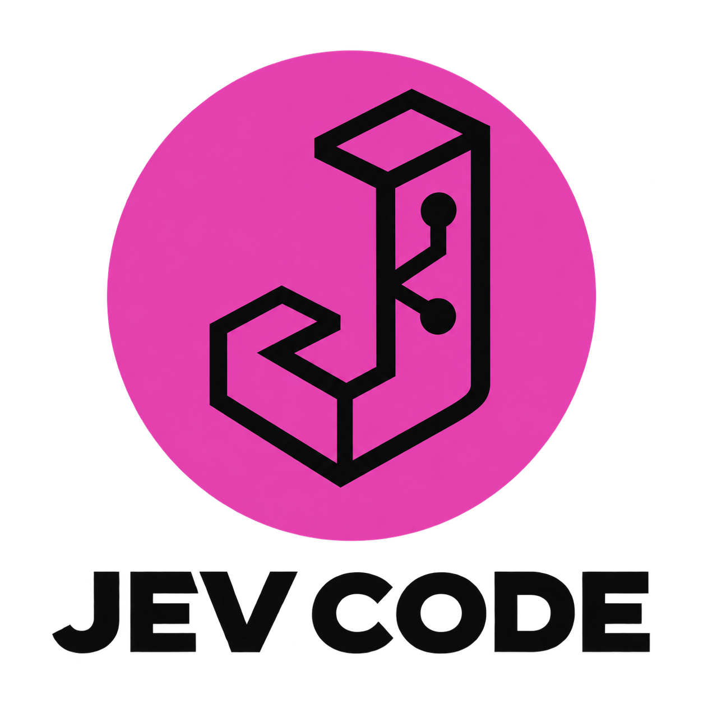

<p align="center">
  
</p>

# jev-code

A TypeScript SDK and coding agent built on [Jev](https://typesafe.ai). You define the options. Jev picks one. Your code runs the effects.

The SDK provides typed decisions, routers, composable programs and bounded tree building. The CLI uses these to build code and shell commands as syntax trees, then validate and run them.

## SDK

```typescript
import { DecisionSession, JevProvider, defineRouter, route } from 'jev-code';

const router = defineRouter({
  inspect: route('Read state', { effect: 'read' } as const),
  modify: route('Change state', { effect: 'write' } as const),
});

const selected = await router.select(
  new DecisionSession(new JevProvider()),
  { request: 'Show the current status' },
  'Choose the application route.',
);

console.log(selected.key, selected.value);
```

Set `TYPESAFE_API_KEY` when using `JevProvider` directly. The package is ESM-only and is not published to npm; see the [SDK guide](docs/sdk.md) for building and installing from source. Runnable examples: [router](examples/router.ts), [dependency tree](examples/dependency-tree.ts).

## Install the CLI

```bash
curl -fsSL https://raw.githubusercontent.com/rhighs/jev-code/main/install.sh | bash
export PATH="$HOME/.local/bin:$PATH"
jev-code login
jev-code
```

macOS and Linux. Uses Node.js 22+ with Corepack if available, otherwise installs a private Node.js 24. Run the installer again to update.

A [typesafe.ai](https://typesafe.ai) API key is required to run model decisions. Your API key is saved in `~/.config/jev-code/config.json` with mode 600. `TYPESAFE_API_KEY` overrides it.

## Agent skill

Install the usage instructions for your coding agent:

```bash
npx skills add rhighs/jev-code
```

This installs the skill, not the CLI or an API key.

## Use it

```bash
jev-code "write a number guessing game in game.py"
jev-code --print "write hello.py and run it"
jev-code --resume last
```

A recorded run building and running `hello.py`:

<p align="center">
  
</p>

Shell commands run on your machine. At the approval prompt, `y` allows once, `n` denies, and `a` allows that tool for the session. `--yes` skips confirmation.

Task text, decision state and relevant file excerpts are sent to TypeSafe’s hosted API. Review what you share before using private code. Runs are saved locally in `.jev/runs/`. Use `jev-code replay <run-id>` to replay one, or `--json --print` for JSON-line events.

## Decisions in the shell

`decide` reads stdin and returns a choice, probability or score. It does not run tools or write files.

```bash
printf '%s\n' 'ValueError: invalid input' | jev-code decide "Is this an error?" --choices yes,no
jev-code decide --score "explains why, not only what" < README.md
tail -n 500 app.log | jev-code decide --true "this line reports a failure" --lines --threshold 0.7
```

Choices exit with the selected label's zero-based index. `--true` exits 0 at or above the threshold, 1 below it. Failures exit 125. Oversized input is rejected unless you pass `--truncate`, which judges only the beginning.

## Limits

Jev has a 32k context. Larger tasks can exhaust the request budget before passing validation. Repair and alternative replay are currently Python-only. The recorded demo is not a reliability benchmark; the [September 18 eval](docs/guide.md#eval-results) failed all three tasks; newer behavior has not been re-evaluated here.

Built-in adapters cover Python, Bash, JavaScript, TypeScript, C, Rust, Go, Lua and Ruby, with different grammar coverage. File generation requires the language's validator on `PATH`.

See the [CLI guide](docs/guide.md) for commands, adapters, journals and recorded eval results, or run `jev-code --help`.

## Project status

Experimental. This repository has no license yet; public access does not grant an open-source license. It is not published to npm. Report non-sensitive bugs through [GitHub issues](https://github.com/rhighs/jev-code/issues).
