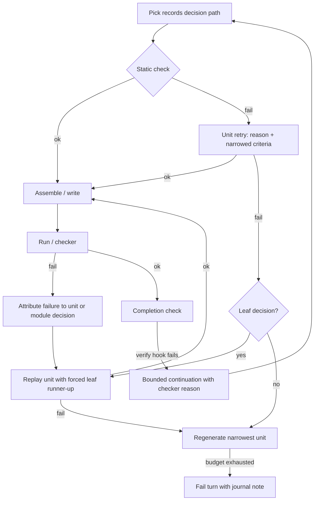
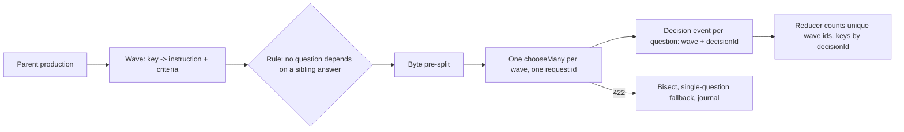

# feat: Repair-first performance and resilience for the generation loop

## Summary

Implement the repair-first roadmap for jev-code: a run-scoped generation context that records decision paths and retained alternatives, repair by leaf-level forced-answer replay plus unit retry (with a checker-driven continuation for eval-style failures), a module-aware Python symbol table, size-safe uncapped decision paths, journal-backed resume with budget carry-over, per-question-criteria batching without dependent questions, a richer custom-string path, and the README plus an asciinema recording. Pushes directly to `main` per the user's instruction, with compensating controls and a live eval check.

---

## Problem Frame

The eval ladder fails 0/3 while spending 2000-3400 requests per task, and the multi-file row is ~20 full rewrites of ~126 requests each. The residual failures are single wrong picks (`randint(range(1 + 100, 100), 100)`, `print('Too low', None)`, `'Name'` vs `'World'`), yet the harness discards the alternatives that could fix them (`src/sdk/decisions.ts:72-76` vs `src/decisions.ts:103-106`), aborts a whole write when one helper unit fails (`src/python-units.ts:72-75`), and has no run-level recovery. Checker-detected output mismatches (the eval checkers run after `Harness.run` returns) have no seam back into the loop today, so the defects that motivate repair are exactly the ones the loop cannot see. A separate review found the uncapped action/completion/field/plan paths can exceed Jev's 32k-token budget (measured 54,783-char action payload by turn 12 in a growth scenario), and that the platform's own guidance is to batch questions and stop asking Jev to compute what code can compute.

---

## Assumptions

*This plan was authored in pipeline mode without synchronous user confirmation. The items below are agent inferences that fill gaps in the input; review them as bets.*

- "All of this" means the roadmap's P0-P2 plus the serializer child and the README/asciinema update; workspace symbol ranking (S1), cross-run notes (S2), and subagent isolation (S4) are deferred to follow-up work.
- The push target is `main` directly (no PR), matching the user's instruction; CI on `main` plus the compensating controls in U13 are the verification gate.
- Live verification is a post-implementation eval run (n=1 per task) plus one real smoke that must trigger at least one repair; the full n=3 eval refresh and search-width comparison are deferred with owner and thresholds.
- The README recording uses a real `--print` run with the saved key; the fallback uses a non-shipped scripted-provider recorder (`scripts/record-cast.ts`) and the README caption states which was used.
- README and guide prose describe mechanisms only until the deferred eval runs; no pass-rate improvement claims ship in this pass.
- The roadmap's "batch token picks 8-per-request" is dropped: token criteria are autoregressive (each pick depends on the accumulated result), so positions are not independent questions. The string target is met with candidate enrichment and longest-piece picks instead; the deviation is recorded.

---

## Requirements

- R1. Repair instead of regenerate: a run-scoped context records each unit's decision path and retained alternatives; repair replays leaf decisions with a forced answer, retries failed units with reasons in state, reuses validated units within a run, and attributes runtime failures (including checker failures through a verify seam) to Python decisions.
- R2. Candidate recall: module-aware symbol table so member calls carry arity and parameter types; typed narrowing for Python arguments (removes the `range(...)`/`None` defect classes at the source).
- R3. Run resilience: a size budget with defined continue paths on the uncapped decision paths; recoverable `max_tokens_exceeded` for single decisions; journal-backed resume with budget carry-over, a partial-effect policy, and no tool-effect replay.
- R4. Batch independent questions per state with per-question criteria and identity, a wave-level request id for accounting, a no-dependent-questions rule, and a defined whole-call failure policy.
- R5. Custom-string path: enrich candidates host-side (literals, identifiers, task fragments, longest pieces) so a task-derived literal resolves in one pick and novel strings cost a few requests instead of up to 32, keeping the 32-piece cap and 3-repeat stop.
- R6. Guardrail feedback: failed static checks retry same-turn with narrowed criteria and the reason in state (Python reasons at width 1 and above; one JS/TS narrowed retry).
- R7. Near-tie handling: one canonical near-tie definition (runner-up gap <= 0.1, or chosen label differs from the probability argmax), recorded on events and consumed by repair.
- R8. Persistent Python serializer child removes per-production `python3 -I -c` spawns across all four bridge operations while preserving per-call cancellation, timeout, and byte-budget semantics.
- R9. README and `docs/guide.md` updated for the new behavior (resume, retries, strings, search width); `docs/media/session.cast` committed with a fresh rendered `docs/media/session.gif` embedded in the README; prose stays mechanism-level.
- R10. All existing tests, typecheck, build, and package-contract pass; new tests cover every behavior change; the result is pushed to `main` and CI is green.
- R11. Live verification: a post-implementation eval run (n=1 per task) records pass/requests/`max_tokens_exceeded`, and one real smoke run triggers at least one repair; results are reported even when the push proceeds.

Target metrics (from the roadmap, tracked by R11; full n=3 refresh deferred):

| Metric | Baseline (docs/guide.md:268-282) | Target |
| --- | --- | --- |
| Eval pass rate (ladder) | 0/3 | >= 1/3 after R1 + R2 + guardrail feedback |
| Requests per eval task | 2000-3400 | -15 to -25% after batching |
| Multi-file row requests | 2516 | < 1000 after tree reuse |
| Deterministic 400s | possible on uncapped paths | zero after R3 |
| Novel string cost | up to 32 requests | a handful; 32 cap retained |

---

## Scope Boundaries

- No change to the default search width (`--search-width` stays as-is) without a live eval comparison.
- No new dialects, no Jev SDK version bump, no changes to `install.sh`.
- Repair and near-tie consumption are Python-only in this pass; third-party AST adapters and other dialects keep current behavior, except the JS/TS single-file guardrail retry (R6, U2, U10). The limitation is documented.
- No candidate-scoring batching in this pass (the wave API cannot carry per-candidate state); search keeps sequential scoring.
- No cross-run persistence of the unit cache in this pass; reuse is run-scoped.
- No dedicated re-ask/shuffle exchangeability probe for order bias; near-ties are marked and consumed by repair.
- No non-Python runtime-failure attribution.

### Deferred to Follow-Up Work

Each item records the roadmap metric it affects and a re-entry trigger.

- S1 workspace symbol ranking: affects multi-file decision quality; re-enter after the deferred eval refresh if multi-file rows remain the dominant failure.
- S2 cross-run notes distilled from `.jev` journals: affects follow-up task cost; re-enter once run-scoped repair is validated.
- S4 subagent isolation for search/read steps: affects per-decision context size; re-enter if state growth still trips size caps after U6.
- Full n=3 eval-ladder refresh and search-width comparison: affects every metric; owner: the follow-up evaluation pass, threshold: the R11 targets; gate on any release citing these changes.
- Persisted (cross-run) unit cache: affects multi-file request counts; re-enter if run-scoped reuse under-delivers against the <1000 target.
- Candidate-scoring batching (needs a per-candidate many-score path) and the order-bias re-ask probe: affect selection quality and request counts; re-enter if near-ties remain the residual failure cause after U10 or if scoring exceeds a meaningful share of eval requests.
- Adapter opt-in for repair/near-tie beyond Python: re-enter when a second adapter needs it.

---

## Context & Research

### Relevant Code and Patterns

- Decision plumbing: `src/decisions.ts` (facade; `choose` drops metadata, `fork` shares only `RunResources`), `src/sdk/decisions.ts` (`topAlternatives`, `chooseMany` with one shared criteria map), `src/decision-context.ts`, `src/scored-grid.ts` (byte pre-split pattern), `src/sdk/resources.ts` (budget starts at zero per run).
- Python generation: `src/python-ast.ts` (builder, `pick`, `terminal` string loop, member calls, `previewOf`), `src/python-nodes.ts`, `src/python-units.ts` (`fillUnits`, `assemble`), `src/python-search.ts` (`searchUnit`, reasons).
- Harness and generation: `src/harness.ts` (turn loop, journaling, `actionCriteria` dedup at 123-147, `tool_start` before execute at 308, `turn_end` in `finally`), `src/generation.ts`, `src/tools.ts` (`write_files` calls `validatePythonProject`), `src/text-plan.ts`, `src/ast-adapters.ts` (`AstAdapter.validate`).
- Eval: `src/eval.ts` runs the checker after `harness.run` returns (108-126); the checker reason is the only failure text for output mismatches.
- Replay/transcript: `src/replay.ts` (start must be first; throws on a torn line), `src/transcript.ts` (request counting per decision event at 121-132; `latest` map keyed by field|unit|candidate; `lowConfidence` strict `< 0.1` at 89-90), `src/print.ts`, `src/render-plain.ts`.
- Dialect narrowing to mirror: `src/lang/core.ts` (`Builtin.params`, `fits`, `fillCall`); JS/TS criteria are computed there.
- Tests: `test/helpers.ts` (`SlotProvider` answers multi-question requests), `test/python-units.test.ts` (abort-all at 96-104; peer-arity no-count at 91), `test/python-search.test.ts`, `test/python-ast.test.ts`, `test/scored-grid.test.ts`, `test/harness.test.ts`, `test/sdk-decisions.test.ts`, `test/replay.test.tsx`, `test/events-baseline.test.ts` (`ADDED` map at 13), `test/package-contract.contract.ts` (declaration assertions at 95-102).
- Conventions: strict TS (`exactOptionalPropertyTypes`, `noUncheckedIndexedAccess`), ESM `.js` import suffixes, no new import cycles (commit `4f46d2d`), additive journal fields only, docs in pairs (`README.md` + `docs/guide.md`).

### Institutional Learnings

- No `docs/solutions/` directory exists; `docs/plans/2026-09-18-001-feat-generation-power-plan.md` already names the repair gap ("One bad pick is final", line 42) and parked auto-resume (line 152) — this plan is the follow-through.

### External References

- TypeSafe platform: batched questions are parallel over one state, answers unchanged; questions cannot depend on sibling answers; 64k token request budget (32k state + longest question); a malformed question fails the whole call (422, not retried); charged per input token; "one question per call" is the named anti-pattern. `chooseMany` is project code; SDK retries 2x on 408/429/5xx with a 10s default timeout (this repo sets 30s).
- asciinema/agg: GitHub filters `<script>`, so the player cannot be embedded; the convention is committing the `.cast` and embedding an agg-rendered GIF (`--theme github-dark --idle-time-limit 1 --speed 1.5 --fps-cap 20`). The repo previously shipped `docs/media/session.cast` (removed in `bccc270`); re-adding it is a return to precedent.

---

## Key Technical Decisions

- **Run-scoped generation context.** One explicit object created in `Harness.run` and threaded through generation options owns the decision-path store, alternatives, unit cache, line-to-slot maps, and the serializer worker. `fork`ed `Decisions` instances share it. It is disposed at run end; direct library callers get a process-scoped default with an explicit close (documented). No module-level singletons.
- **Decision identity includes a monotonic id and the question key.** Slots repeat (`argument_${i}`) and a wave shares one state, so `field/phase/slot/unit/candidate` alone is not unique. Events carry additive `decisionId` and `wave` fields; downstream consumers key by `decisionId`, not slot; alternatives are invalidated when their unit is regenerated.
- **Replay contract (leaf-only).** Every builder decision registers a path entry or is host-derived. Forced-answer replay applies to leaf decisions (terminals: number, string, identifier); a structural override (callee, production) invalidates downstream entries, so structural failures fall back to regeneration instead of an inconsistent replay. Module-slot failures use leaf substitution in the assembled tree, not replay; unit replay is reserved for unit-body failures. Replay determinism is tested with an override that changes callee/arity and must degrade to regeneration deterministically.
- **Repair budget: 2 cycles per write**, then the turn fails with a journal note; a committed repair invalidates units that call or are called by the repaired unit (the call graph exists for cross-imports) and re-runs assembled validation before commit.
- **Checker-driven continuation.** `Harness` gains an optional `verify` hook: after a completed run, the verifier runs; on failure its reason is appended as input and the loop continues, bounded to one continuation per run and journaled. `src/eval.ts` passes its checker as the verifier, so output mismatches (the motivating defects) can be repaired in-loop.
- **Failure taxonomy.** Provider/limit errors are fatal to the unit; static-check failures are retryable once with the reason; a second retryable failure aborts the pool (the existing abort-all test changes to assert double-failure abort). Width 1 gets a per-unit static check before assembly so retry is possible without search.
- **Reason-to-narrowing table.** `arity` forbids the offending peer call; `return` forces a return; `undefined` restricts references to defined names; `compile` is not narrowable, so the retry includes the source snippet and reason and the unit is otherwise unchanged.
- **Wave API carries per-question criteria.** The wave takes `Record<key, {instruction, criteria}>`; questions with fewer than 2 labels are resolved host-side and never enter a wave; **no wave contains a question whose criteria depend on a sibling answer**. The call site therefore uses: callee alone; `argument_count` host-derived from the callee's symbol arity when known (U5), else a post-callee single question; sibling arguments and binary/compare children as their own waves; the unit spec split into name+arity+purpose then params. Candidate-scoring batching is dropped.
- **Wave failure policy.** SDK-retried 408/429/5xx surface after retries; 422/invalid-response triggers bisection until the bad question is isolated. A skipped question falls back to a single-question request for the owning production; if that also fails, the unit fails loudly with the skipped question journaled, and a question shape is blacklisted after one repeat bisection. A budget pre-check (n singles worst case, plus bisection overhead) runs before sending a wave.
- **One request per wave.** The wave allocates a request id; each answered question emits a decision event carrying `wave` and `decisionId`; the transcript reducer counts unique wave ids and keys by `decisionId`; print/`--json`/the events fixture follow.
- **Size safety uses bytes as a token proxy.** The 24k-byte cap pattern extends to action select, completion check, field choices, and plan selects, compacting before send. Over-budget after compaction: field decisions become a failed field record; the completion check becomes a rejected completion labeled as a size failure in the summary; a plan select is skipped with a note; the action decision counts consecutive size failures and ends the run as `limited` at 3, with an error naming path, bytes, cap, and trimmed keys.
- **`max_tokens_exceeded` recovery generalizes** from `chooseMany` to single decisions via an optional caller-supplied retry-state builder (facade `choose`/`probability`/`score` accept a compact hook; harness/generation call sites pass a `compactContext`-based builder): compact, retry once, then fail that decision only.
- **Resume contract.** `--resume <run-id|last>` is a mode (like `replay`), not combinable with a positional prompt, and requires journaling; resumable statuses are `blocked`, `limited`, `cancelled`, `error` (eligibility is "no `end` event with status `completed`", so the summary hint and eligibility agree). A resumed run writes a new journal whose `start` event carries additive `resume: {from}`; replay and the transcript treat the second `start` as a continuation marker. Eligibility requires the journal to exist, lack a completed `end`, and match the workspace realpath; eval journals (temp workspaces) are refused with a clear message. Reading truncates at the last complete `turn_end`, tolerates a partial final line, and applies the partial-effect policy: an unmatched `tool_start` for an effectful shell tool (bash) refuses resume with a clear message; read-only and file-write starts are excluded from the re-run with a synthesized unknown record. Resume point is max(`turn_end`)+1 with records rebuilt from `tool_end` events and original turn numbers kept. Turns and requests carry over through an explicit initial-usage seam (seeded into `RunResources`/`Decisions` from the last `turn_end`, with the transcript counter seeded from the `resume` field so live counter, `end.requests`, and the enforced budget agree); wall-clock and generation steps reset with a documented note. Alternatives are rebuilt best-effort from journaled decision `options`; unit cache, observations, and conversation summaries reset, and `state.rules` carries a resume note. Claim wording: no journaled tool effect is replayed.
- **String path: enrichment plus longest pieces, no token batching.** Token criteria depend on the accumulated result, so parallel token picks are invalid. Enrichment adds phrase/quoted literals, identifiers, task fragments, and multi-character pieces; a task-derived literal resolves in one pick and novel strings are expected within a handful of requests, keeping the 32-piece cap and 3-repeat stop.
- **Serializer worker is multiplexed and context-reachable.** One JSONL worker per run covers four bridge operations (unparse, source compile, project validate, candidate check) with per-request ids; cancellation rejects only that request, crash/timeout deterministically rejects all in-flight calls and restarts, per-call root/cwd is preserved with serialized request handling, the spawner is injectable for tests, and the run context owns disposal. The context is threaded to the validate paths through an additive parameter on `AstAdapter.validate`/`validateProject` and `ToolContext` (adding `src/ast-adapters.ts` and `src/tools.ts`). A spawn-per-call fallback covers a missing `python3`.
- **Near-tie boundary is inclusive: gap <= 0.1** or chosen label differs from the probability argmax. The transcript's existing `lowConfidence` keeps its strict `< 0.1` comparison (documented as intentionally different).
- **Public SDK surface stays additive.** New wave/alternatives methods land in `src/sdk/index.ts`; `docs/sdk.md` and the package-contract declaration assertions are updated in the same pass. No examples change is promised.
- **Cast fallback is a real recorder.** `scripts/record-cast.ts` (non-shipped) drives `Harness`/`printRun` with a local scripted provider so the fallback is executable without a key; the README caption states which provider produced the recording.

---

## Open Questions

### Resolved During Planning

- How a slot's runner-up is applied: leaf-only forced-answer replay; structural failures regenerate; module-slot failures substitute leaves in the assembled tree.
- Repair loop bound: 2 cycles per write, then fail the turn with a journal note.
- Checker seam: `Harness` `verify` hook with one bounded continuation; `src/eval.ts` passes its checker.
- Width-1 retry: per-unit static check before assembly; fatal-vs-retryable taxonomy defined.
- Batching contract: per-question criteria, no dependent questions, callee alone and count host-derived (or post-callee), unit-spec split, field wave restricted to choice-shaped fields, candidate scoring dropped.
- Wave failure: bisect on 422/invalid-response, single-question fallback, then loud unit failure; shape blacklist after repeat; budget pre-check includes bisection overhead.
- Request accounting: one request id per wave; per-question decision events keyed by `decisionId`; reducer dedupes by wave id.
- Resume budget: explicit initial-usage seam; transcript seeds from the `resume` field; turns and requests carry over; wall-clock and steps reset.
- Partial-turn rule: truncate at the last complete `turn_end`; unmatched `tool_start` policy defined (bash refuses, reads/writes excluded with an unknown record); torn final line tolerated.
- Resume lineage and statuses: new journal with `resume: {from}`; `blocked` is resumable; eligibility is "no completed end"; tail-only replay documented.
- Dropped search candidates: retain validated ones as repair candidates.
- Token batching: dropped; enrichment plus longest pieces instead.
- Near-tie boundary: gap <= 0.1 inclusive; transcript keeps strict `<`.

### Deferred to Implementation

- Exact line-to-slot map shape for Python tracebacks: depends on the assembled source layout discovered while implementing U4.
- Byte thresholds per decision path after compaction: tune against real payload sizes in tests.
- Worker command envelope shape for the four bridge operations: decide while implementing U11.
- Final recording length and demo task: depends on the smoke run; the demo must be a real passing task when available.

---

## High-Level Technical Design

> *This illustrates the intended approach and is directional guidance for review, not implementation specification.*

Repair flow with leaf replay and checker continuation:

Wave batching with the dependency rule:

---

## Implementation Units

### U14. Run-scoped generation context

**Goal:** One explicit object owns run-scoped generation state (decision paths, alternatives, unit cache, line-to-slot maps, serializer worker), created in `Harness.run`, shared by unit forks, and disposed at run end.

**Requirements:** R1, R8

**Dependencies:** None

**Files:**
- Create: `src/run-context.ts`
- Modify: `src/harness.ts`
- Modify: `src/generation.ts`
- Modify: `src/python-ast.ts`
- Modify: `src/python-units.ts`
- Modify: `src/decisions.ts`
- Test: `test/harness.test.ts`
- Test: `test/python-units.test.ts`

**Approach:**
- Define the context shape and lifecycle: create in `Harness.run`, pass through `GenerateOptions`, share with forked `Decisions`, dispose on run end (including worker shutdown).
- No module-level singletons; direct library callers get a process-scoped default with an explicit close (documented).
- Add an isolation test running two sequential runs in one process.

**Patterns to follow:**
- `Harness.run` lifecycle in `src/harness.ts:150-345`; `fork` sharing in `src/decisions.ts:62-68`; resources gate in `src/sdk/resources.ts`.

**Test scenarios:**
- Happy path: a run's decisions are visible to unit forks through the context.
- Edge case: two sequential runs in one process do not leak alternatives, caches, or workers into each other.
- Error path: disposing a context shuts the worker down and rejects later use with a clear error.
- Integration: a direct library call path (`DecisionSession` outside the harness) creates and closes a default context; two concurrent direct callers do not cross-talk.

**Verification:** A context probe shows one context per run and zero cross-run leakage.

---

### U1. Alternatives retention, decision-path recording, and near-tie marking

**Goal:** Record an ordered decision path per unit attempt with alternatives, and mark near-tie choices from one canonical definition (gap <= 0.1 inclusive, or chosen != argmax).

**Requirements:** R1, R7

**Dependencies:** U14

**Files:**
- Modify: `src/decisions.ts`
- Modify: `src/sdk/decisions.ts`
- Modify: `src/sdk/index.ts`
- Modify: `src/types.ts`
- Modify: `src/python-ast.ts`
- Test: `test/decisions.test.ts`
- Test: `test/sdk-decisions.test.ts`
- Test: `test/python-ast.test.ts`

**Approach:**
- Add an alternatives-aware choose path that stores `{decisionId, questionKey, identity, chosen, alternatives, nearTie}` in the run context; keep the existing `choose` for callers that do not need it.
- Allocate a monotonic decision id per decision (and per question in a wave); attach `decisionId` and `nearTie` to decision events additively in `src/types.ts`.
- The Python builder registers each pick's path entry (leaf or structural) so the unit can be replayed per the leaf-only contract; entries are invalidated when the unit is regenerated.
- Near-tie is computed once here (inclusive boundary); the transcript keeps deriving `lowConfidence` with its strict comparison (no coupling).

**Patterns to follow:**
- `topAlternatives` in `src/sdk/decisions.ts:72-76`; identity in `src/decisions.ts:28-38`; additive event fields in `src/types.ts:84-96`.

**Test scenarios:**
- Happy path: a unit's path records each decision with alternatives, a decision id, and leaf/structural kind.
- Edge case: a gap of exactly 0.1 marks `nearTie: true`; a chosen-label-not-argmax distribution marks it too; a gap of 0.11 does not.
- Error path: a provider failure leaves the path unchanged for that attempt.
- Integration: regenerating a unit invalidates its previous path entries; downstream event consumers key by `decisionId`.

**Verification:** A recorded path can be replayed deterministically in tests and near-tie flags match the inclusive definition.

---

### U2. Unit-level repair retries with reasons and narrowing

**Goal:** A failing helper unit retries in place with the reason in state and narrowed criteria at any search width; only a second retryable failure aborts the write. JS/TS single-file validation failures get one narrowed retry.

**Requirements:** R1, R6

**Dependencies:** U1, U14

**Files:**
- Modify: `src/python-units.ts`
- Modify: `src/python-ast.ts`
- Modify: `src/generation.ts`
- Modify: `src/lang/core.ts`
- Test: `test/python-units.test.ts`
- Test: `test/generation.test.ts`

**Approach:**
- Add a per-unit static check before assembly so width-1 units are retryable; keep the search hooks path for width > 1.
- Apply the reason-to-narrowing table; `compile` retries with the snippet and reason and no criteria change.
- Define fatal (provider/limit) vs retryable (static) failures; second retryable failure aborts the pool. Update the existing abort-all test to assert the double-failure case; keep the peer-arity no-count behavior.
- For JS/TS single files, pass a `generation.syntax` hint that `src/lang/core.ts` consumes to drop matching productions, plus the diagnostic in state; if the hint proves infeasible, the retry is message-only and the plan notes the downgrade. Other dialects unchanged.
- Pin repair tests to concurrency 1, or define which failure wins under the shared gate.

**Patterns to follow:**
- `checkCandidate` reasons in `src/python-ast.ts:183-214`; `SearchHooks` seam in `src/python-search.ts:7-14`; `syntaxFeedback` in `src/generation.ts:34-41`; criteria computation in `src/lang/core.ts`.

**Test scenarios:**
- Happy path: one static failure retries with the reason present and the narrowed criteria, and the write succeeds.
- Edge case: width 1 retries via the new per-unit check; a unit that fails twice still aborts the pool (updated test); a peer-arity call asks no count question.
- Error path: a retry failing with a different reason surfaces the second reason; a fatal provider error does not retry.
- Integration: request accounting shows the retry costs only the unit's productions; JS/TS diagnostics retry with the offending production removed.

**Verification:** Scripted runs show exactly one narrowed retry per retryable failure and unchanged fatal-error behavior.

---

### U3. Within-run tree reuse

**Goal:** Rewrites of the same path and task reuse validated units instead of regenerating everything, with dependency-aware invalidation after repairs.

**Requirements:** R1

**Dependencies:** U2, U14

**Files:**
- Modify: `src/python-units.ts`
- Modify: `src/python-ast.ts`
- Test: `test/python-units.test.ts`
- Test: `test/write-files.test.ts`

**Approach:**
- Cache validated unit bodies and symbols in the run context keyed by `(path, normalized task text)`; regenerate only missing or invalidated units and revalidate the assembled result on reuse.
- Clear a path's entries when its task text changes; keep entries after failed writes so the next attempt is monotonic.
- Dependency rule: a committed repair invalidates units that call or are called by the repaired unit; re-run assembled validation before commit.
- Preserve width-1 parity: with an empty cache the request sequence is identical (existing test).

**Patterns to follow:**
- `assemble`/`assembleProject` in `src/python-units.ts:78-118`; `generatePythonProject` in `src/python-ast.ts`.

**Test scenarios:**
- Happy path: a second write to the same path reuses validated units with no requests for them.
- Edge case: a changed task text invalidates the entry and regenerates; a repaired unit invalidates its callers.
- Error path: a cached unit that fails revalidation is regenerated, not reused.
- Integration: a failing write followed by a rewrite keeps validated units and regenerates only the failed one and its dependents.

**Verification:** Second-write request counts drop to the changed units only.

---

### U4. Runtime-failure attribution, leaf replay, and checker continuation

**Goal:** Map a failed run or checker result to the Python decision that produced it and repair by replaying leaf decisions or regenerating, with a bounded checker-driven continuation.

**Requirements:** R1, R7

**Dependencies:** U1, U3, U14

**Files:**
- Modify: `src/python-units.ts`
- Modify: `src/python-ast.ts`
- Modify: `src/harness.ts`
- Modify: `src/eval.ts`
- Test: `test/harness.test.ts`
- Test: `test/python-units.test.ts`
- Test: `test/eval.test.ts`

**Approach:**
- Assembly records a line-to-slot map per written file (unit definitions and module statements with source spans).
- On a failed run result (bash execution) extract the first failure location (traceback line, stderr line) and map it to a decision: unit-body failures replay the unit with a forced leaf runner-up (structural decisions fall back to regeneration); module-slot failures substitute the failing leaf in the assembled tree from recorded alternatives.
- Add the `verify` hook to `Harness`: after a completed run, the verifier (eval checker) runs; on failure its reason is appended as input and the loop continues, bounded to one continuation per run and journaled. This is the seam that lets the motivating output mismatches reach repair.
- Budget: 2 repair cycles per write; then fail the turn with a journal note. Terminal fallback order: leaf replay/substitution, regenerate the narrowest unit, fail the turn.
- Revalidate alternatives before reuse; consume alternatives only when the repaired write commits. Retain validated dropped search candidates as repair candidates and journal them; give all-dropped search failures their own retry path. Non-Python runtime repair is out of scope and documented.

**Patterns to follow:**
- Failure observation into state in `src/harness.ts:202-212,316-319`; eval checker reasons in `src/eval.ts:108-110`; dropped candidates in `src/python-search.ts:33-39`.

**Test scenarios:**
- Happy path: a failing run's traceback maps to a leaf decision, the forced runner-up fixes the output, and no regeneration requests occur.
- Edge case: a structural failure skips replay and regenerates; a module-slot failure substitutes the leaf in the assembled tree; a failure that maps to no slot falls back with a journal note.
- Error path: exhausting 2 cycles fails the turn with a journal note; an alternative that fails revalidation is discarded.
- Integration: a checker failure after a completed run triggers one bounded continuation and is repaired; the journal shows attribution, replay, and the forced decision id.

**Verification:** A scripted failing run is repaired in the same turn with no full rewrite, bounded by the 2-cycle budget; a checker failure continues once.

---

### U5. Module-aware Python symbol table and typed narrowing

**Goal:** Member calls carry arity and parameter types; Python argument generation narrows by expected type, removing the `range(...)` and `None` defect classes and enabling host-side argument-count derivation.

**Requirements:** R2

**Dependencies:** None (parallel)

**Files:**
- Create: `src/python-symbols.ts`
- Modify: `src/python-ast.ts`
- Modify: `src/python-nodes.ts`
- Test: `test/python-ast.test.ts`
- Test: `test/python-units.test.ts`

**Approach:**
- Add a curated member table for the offered modules (at least `random`, `math`, `time`, `os`, `sys`) with arity, parameter types, and common return types (`random.randint(a: number, b: number)`, `input() -> string`, `math.sqrt(x: number) -> number`).
- Extend the Python `Symbol` shape with optional params and use a Python-local narrowing helper shaped like `lang/core.ts` `fits`/`fillCall`; do not import `lang/core.ts` into the Python builder (cycle risk), note unification as follow-up.
- The member-call path fills the callee from the member table instead of spelling the method; argument generation filters candidates by parameter type; when the callee's arity is known, the argument count is derived host-side (no question).

**Patterns to follow:**
- `builtinArity` in `src/python-ast.ts:20-21`; `fits`/`fillCall` in `src/lang/core.ts:161-194`; symbol plumbing in `src/python-nodes.ts`.

**Test scenarios:**
- Happy path: `random.randint` offers exactly two number arguments and no `range(...)` or `None` candidate; the count is host-derived.
- Edge case: an unknown member falls back to the spelling path without regression.
- Error path: a member used with the wrong arity is not offered.
- Integration: the guessing-game fixture no longer offers `range(...)` as a `randint` argument; the peer-arity no-count test stays green.

**Verification:** Scripted tests show narrowed criteria for module members; the two defect classes cannot be produced by the offered criteria.

---

### U6. Size-aware budget on the uncapped decision paths

**Goal:** Action select, completion check, field choices, and plan selects never send an over-budget request, and over-budget has a defined continue path with quality safeguards.

**Requirements:** R3

**Dependencies:** None (parallel)

**Files:**
- Modify: `src/harness.ts`
- Modify: `src/generation.ts`
- Modify: `src/text-plan.ts`
- Modify: `src/decision-context.ts`
- Test: `test/harness.test.ts`
- Test: `test/generation.test.ts`
- Test: `test/decision-context.test.ts`

**Approach:**
- Apply the 24k-byte cap pattern to the four uncapped paths, compacting `history`/`recent` (one-line records, trimmed outputs) and re-measuring.
- Over-budget after compaction: field decisions become a failed field record; the completion check becomes a rejected completion labeled as a size failure in the summary (so the existing 3-rejection path does not misattribute the cause); a plan select is skipped with a note; the action decision tracks consecutive size failures and ends the run as `limited` at 3 with an error naming path, bytes, cap, and trimmed keys.
- Keep the existing AST/grid caps unchanged.

**Patterns to follow:**
- `compactContext` in `src/scored-grid.ts:11-22`; `buildDecisionContext` trimming in `src/decision-context.ts:10-26`; `astDecisionState` byte accounting at `decision-context.ts:68`.

**Test scenarios:**
- Happy path: a 60-turn state with large outputs compacts and stays under the cap.
- Edge case: a state that fits only after compaction still sends; a state that cannot fit fails the decision, not the run; a prior failure's reason survives compaction or is re-requested in the next turn's state.
- Error path: three consecutive action-size failures end the run as `limited` with the named fields in the error; a size-rejected completion is labeled as a size failure.
- Integration: a long scripted run reaches turn 60 without a provider error.

**Verification:** The growth scenario compacts below the cap in tests; the `limited` terminal path and the size-failure labeling are exercised.

---

### U7. Recoverable `max_tokens_exceeded` and journal-backed resume

**Goal:** Single decisions recover once from a byte-cap rejection by compacting, and an interrupted run resumes from its journal at the next turn with budget carry-over and no journaled tool-effect replay.

**Requirements:** R3

**Dependencies:** U6, U14

**Files:**
- Modify: `src/decisions.ts`
- Modify: `src/sdk/resources.ts`
- Modify: `src/harness.ts`
- Modify: `src/cli.ts`
- Modify: `src/replay.ts`
- Modify: `src/transcript.ts`
- Modify: `src/render-plain.ts`
- Modify: `src/types.ts`
- Test: `test/decisions.test.ts`
- Test: `test/harness.test.ts`
- Test: `test/replay.test.tsx`

**Approach:**
- Generalize split-on-`max_tokens_exceeded` to single choose/probability/score calls via an optional caller-supplied retry-state builder (a compact hook passed by harness/generation call sites): compact, retry once, then fail that decision only.
- Add `--resume <run-id|last>` as a mode with the resume contract from Key Technical Decisions: eligibility (no completed end), `blocked` included, workspace realpath check, eval-journal refusal, truncation at the last `turn_end`, torn-line tolerance, partial-effect policy (bash refuses; reads/writes excluded with an unknown record), `resume: {from}` in the new `start` (typed in `src/types.ts`), continuation-marker handling in replay/transcript, resume point max(`turn_end`)+1, records from `tool_end`, turns and requests carried over through an explicit initial-usage seam in `RunResources`/`Decisions`, transcript counter seeded from the `resume` field, wall-clock/steps reset, run-scoped state reset with a `state.rules` note, alternatives rebuilt best-effort from journaled options.
- Summary prints a `resume with jev-code --resume <id>` hint for non-completed runs; CLI help gains `--resume`; journaling is required.
- Keep journal schema 1; resume is additive.

**Patterns to follow:**
- Split logic in `src/decisions.ts:119-135`; journal reader in `src/replay.ts:11-33`; CLI parsing in `src/cli.ts:156-164,210-216`; run id in `src/render-plain.ts:59`; resource usage in `src/sdk/resources.ts:115,161-164`.

**Test scenarios:**
- Happy path: a decision that hits `max_tokens_exceeded` compacts and succeeds on retry; a resumed run carries over turns/requests and the live counter, `end.requests`, and the enforced budget agree.
- Edge case: a second rejection fails that decision only; a journal with a torn final line resumes from the last complete `turn_end`; a `blocked` run is resumable; an unmatched `tool_start` for bash refuses resume with a clear message, while a read/write start is excluded with an unknown record.
- Error path: `--resume` with a missing journal, a workspace mismatch, an eval journal, or a completed run exits with a clear message.
- Integration: a run interrupted mid-turn resumes at the next turn, does not replay journaled tool effects, keeps turn numbering, and completes; replay of the resumed journal renders the continuation marker.

**Verification:** Resumed runs show carried-over turns/requests, no journaled tool-effect replay, and a tail-only replay that renders cleanly.

---

### U8. Per-question-criteria batching with the dependency rule

**Goal:** Independent questions batch into one request per wave with per-question criteria and identity, correct accounting, and a defined failure policy.

**Requirements:** R4

**Dependencies:** U1, U14

**Files:**
- Modify: `src/decisions.ts`
- Modify: `src/sdk/decisions.ts`
- Modify: `src/sdk/index.ts`
- Modify: `src/types.ts`
- Modify: `src/python-ast.ts`
- Modify: `src/python-units.ts`
- Modify: `src/generation.ts`
- Modify: `src/transcript.ts`
- Modify: `src/print.ts`
- Test: `test/python-ast.test.ts`
- Test: `test/python-units.test.ts`
- Test: `test/generation.test.ts`
- Test: `test/transcript.test.ts`
- Test: `test/events-baseline.test.ts`

**Approach:**
- Add the wave API at session and facade layers: `Record<key, {instruction, criteria}>`, one request id per wave, byte pre-split, per-question identity (`decisionId` + `wave`, typed in `src/types.ts`).
- Enforce the rule: no wave contains a question whose criteria depend on a sibling answer. Resolve questions with fewer than 2 labels host-side; never include a short-circuit question in a wave. Call site waves: callee alone; `argument_count` host-derived when arity is known else post-callee single; sibling arguments; binary/compare children; unit spec split into name+arity+purpose then params; tool field wave restricted to choice-shaped fields. Candidate-scoring batching is dropped.
- Failure policy: classify provider errors; bisect on 422/invalid-response until the bad question is isolated; a skipped question falls back to a single-question request for the owning production, and a second failure fails the unit loudly with the skipped question journaled; blacklist a question shape after one repeat bisection; budget pre-check includes bisection overhead.
- Events: one decision event per question with `wave` and `decisionId`; the transcript reducer counts unique wave ids and keys by `decisionId`; print/`--json` and the fixture `ADDED` map follow.

**Patterns to follow:**
- `chooseMany` in `src/decisions.ts:119-135` and `src/sdk/decisions.ts:224-251`; grid pre-split in `src/scored-grid.ts:69-88`; request counting in `src/transcript.ts:121-132`; fixture map in `test/events-baseline.test.ts:13`.

**Test scenarios:**
- Happy path: sibling arguments and binary/compare children batch into one request, consume all answers, and count as one request.
- Edge case: a wave over the byte budget pre-splits; the callee wave contains no count question; a host-derived count asks nothing.
- Error path: a 422 isolates the bad question via bisection and falls back to a single-question request; a second failure fails the unit loudly; a 5xx surfaces after SDK retries.
- Integration: transcript, print, and `--json` show per-question events with one request increment, matching wave ids, and `decisionId`-keyed pairing.

**Verification:** Scripted request counts drop for batched waves while outputs and request accounting stay identical.

---

### U9. String path enrichment and longest-piece picks

**Goal:** A task-derived literal resolves in one pick and novel strings cost a few requests instead of up to 32, without invalid parallel token picks.

**Requirements:** R5

**Dependencies:** U8

**Files:**
- Modify: `src/python-ast.ts`
- Modify: `src/lang/core.ts`
- Modify: `src/vocab.ts`
- Test: `test/python-ast.test.ts`
- Test: `test/lang-core.test.ts`

**Approach:**
- Seed `custom` token criteria with phrase literals, quoted literals, identifiers, task fragments, and multi-character pieces, preferring the longest matching piece so one pick advances several characters.
- Keep the 32-piece cap, 3-repeat stop, `end` semantics, and byte-budget failure; do not batch token positions (criteria depend on the accumulated result).
- Keep label counts within the validated drift tolerance.

**Patterns to follow:**
- `terminal` in `src/python-ast.ts:254-274`; `phraseLiterals`/`quotedLiterals` in `src/vocab.ts:6-20`; drift validation in `src/sdk/decisions.ts:52-70`.

**Test scenarios:**
- Happy path: a custom literal present in the task resolves from an enriched candidate in one pick.
- Edge case: a novel literal spells via longest pieces and stops at 3 repeats; a literal absent from all candidates still terminates under the byte budget and the 32-piece cap.
- Error path: an over-budget terminal throws the existing byte-budget error.
- Integration: scripted request counts for a novel string stay within a handful of requests.

**Verification:** Task-derived literals take 1 request; novel strings take a handful; the 32-piece cap and 3-repeat stop are unchanged.

---

### U10. Near-tie repair consumption and JS/TS guardrail narrowing

**Goal:** Repair prefers near-tie alternatives before regeneration, and JS/TS validation failures retry once with the diagnostic in state.

**Requirements:** R6, R7

**Dependencies:** U1, U2, U4

**Files:**
- Modify: `src/python-ast.ts`
- Modify: `src/generation.ts`
- Modify: `src/lang/core.ts`
- Modify: `src/scored-grid.ts`
- Test: `test/python-ast.test.ts`
- Test: `test/generation.test.ts`
- Test: `test/scored-grid.test.ts`

**Approach:**
- When a failure is attributed to a near-tie leaf decision, consume that decision's alternatives in probability order through forced-answer replay before any regeneration; otherwise regenerate.
- For JS/TS single files, retry once with `syntaxFeedback` messages in state and the failing production removed via the `generation.syntax` hint consumed in `src/lang/core.ts`; keep the grid's existing repair round.
- Journal both paths additively; repair counts as progress for `actionCriteria` (dedup behavior unchanged); adapters keep current behavior (Python-only repair, documented).

**Patterns to follow:**
- Repair ordering from U4; `syntaxFeedback` in `src/generation.ts:34-41`; grid repair in `src/scored-grid.ts:121-133`.

**Test scenarios:**
- Happy path: a near-tie decision's runner-up fixes the failure with zero new generation requests.
- Edge case: a non-near-tie failure skips alternatives and regenerates; an exhausted alternative list regenerates once.
- Error path: a JS/TS retry that fails again surfaces the second diagnostic without looping.
- Integration: `actionCriteria` continues to dedup repeated failures after a repair.

**Verification:** Repair tests show alternative-first ordering for near-ties and a single JS/TS narrowed retry.

---

### U11. Multiplexed Python serializer worker

**Goal:** Remove per-production `python3 -I -c` spawns across all four bridge operations while preserving per-call cancellation, timeout, and byte-budget behavior.

**Requirements:** R8

**Dependencies:** U14 (lands after U8 to avoid churn; first candidate for the shrink cut)

**Files:**
- Create: `src/python-worker.ts`
- Modify: `src/python-ast.ts`
- Modify: `src/ast-adapters.ts`
- Modify: `src/tools.ts`
- Test: `test/python-ast.test.ts`
- Test: `test/python-search.test.ts`

**Approach:**
- One lazy per-run JSONL worker covering four bridge operations (unparse, source compile, project validate, candidate check) with per-request ids; cancellation rejects only that request and leaves siblings in flight; crash or timeout deterministically rejects all in-flight calls and restarts; per-call root/cwd is preserved with serialized request handling.
- Thread the run context to the validate paths through an additive parameter on `AstAdapter.validate`/`validateProject` and `ToolContext`; the run context owns disposal; direct library callers get the process-scoped default from U14.
- Inject the spawner for tests (spawn-count probe); a spawn-per-call fallback covers a missing or repeatedly crashing `python3`.
- Rationale for inclusion: the measured spawn cost is 15.1 ms per production (~4-5% of serial generation); it is the first cut if the pass must shrink.

**Patterns to follow:**
- `runPythonJson` in `src/python-ast.ts:59-87`; abort test in `test/python-ast.test.ts:97-102`; `AstAdapter.validate` in `src/ast-adapters.ts:24-25`; `write_files` validation in `src/tools.ts:224`.

**Test scenarios:**
- Happy path: 50 sequential renders reuse one child (spawn count asserted through the injectable spawner); all four operations route through the worker.
- Edge case: cancelling one request leaves concurrent sibling renders unaffected.
- Error path: killing the child mid-run restarts it on the next call; a missing `python3` falls back to spawn-per-call; in-flight calls reject deterministically on crash.
- Integration: byte-budget errors and validation results are identical to the spawn path; `write_files` validation reaches the worker.

**Verification:** Render-heavy tests show one child per run, sibling-safe cancellation, all four operations covered, and identical outputs.

---

### U12. README, guide, SDK docs, and asciinema recording

**Goal:** Docs match the new behavior and the README embeds a fresh recording sourced from a committed cast; prose stays mechanism-level.

**Requirements:** R9

**Dependencies:** U1-U11, U14 (recording happens after code is final)

**Files:**
- Modify: `README.md`
- Modify: `docs/guide.md`
- Modify: `docs/sdk.md`
- Create: `docs/media/session.cast`
- Modify: `docs/media/session.gif`
- Create: `scripts/record-cast.ts`

**Approach:**
- Record a real `--print` session with the saved key; the demo task comes from the smoke run's real passing tasks when available. The fallback uses `scripts/record-cast.ts` (non-shipped) driving `Harness`/`printRun` with a local scripted provider; the README caption states which provider produced the recording.
- Commit the cast and render the GIF with agg (`github-dark`, idle-time-limit 1, speed 1.5, fps-cap 20); keep it comfortably small.
- README: embed the GIF and add the `asciinema play docs/media/session.cast` line; describe mechanisms (repair, batching, resume, string enrichment) without pass-rate or performance claims until the deferred eval runs.
- `docs/guide.md`: fix the no-auto-resume statement (now `--resume`), "one failing helper aborts the whole write" (now retries once), and the strings sentence (now enriched; the 32-piece cap and 3-repeat stop remain, so the old bound becomes incomplete rather than false); update search-width notes; document resume eligibility, the partial-effect policy, and the tail-only replay limitation.
- `docs/sdk.md`: document the additive wave/alternatives surface.

**Patterns to follow:**
- README media block at `README.md:48-50`; previous cast convention removed in `bccc270`; `docs/guide.md:118`, `92`, `266-282`; CLI provider construction in `src/cli.ts:217-219`.

**Test scenarios:**
- Test expectation: none -- documentation, media, and a non-shipped recorder script; verified by rendering the GIF, playing the cast locally, checking README links resolve, and running the recorder with a scripted provider.

**Verification:** The GIF renders in the README block, the cast plays with `asciinema play`, the fallback recorder runs without a key, and guide statements match shipped behavior.

---

### U13. Integration verification and release hygiene

**Goal:** Everything passes together, the change is live-verified, and the push to `main` is green with a revert point.

**Requirements:** R10, R11

**Dependencies:** U1-U12, U14

**Files:**
- Test: `test/fixtures/events-baseline.jsonl` (regenerate for additive fields)
- Test: `test/package-contract.contract.ts` (update declaration expectations for the additive SDK surface)

**Approach:**
- Run `pnpm install --frozen-lockfile`, then typecheck, full tests, build, and package-contract locally on the exact commit being pushed.
- Regenerate the events baseline fixture; update package-contract expectations for additive declarations.
- Run the R11 live verification: one real smoke (`--print` small task) that triggers at least one repair (static or runtime) and keeps its journal as evidence; then the eval ladder once per task (n=1), recording pass/requests/`max_tokens_exceeded` for all three tasks. Report the results even when the push proceeds; if the pass must shrink, the eval run is recorded as a residual with the deferred full refresh.
- Compensating controls for the direct push: record the pre-push SHA as a one-command revert point, run the full suite plus smoke on the exact commit, and make the deferred n=3 eval refresh a gate on any release citing these changes.
- Push to `main` and watch CI; fix failures at the root cause.

**Patterns to follow:**
- CI steps in `.github/workflows/ci.yml`; fixture regeneration in `test/events-baseline.test.ts:47`; contract assertions in `test/package-contract.contract.ts:95-102`.

**Test scenarios:**
- Integration: full suite passes on Node 22 with Python 3.12; two sequential runs in one process stay isolated.
- Integration: mid-turn crash resume, replay-of-resumed-journal, and checker-continuation tests pass.
- Integration: the live smoke triggers a repair; the n=1 eval run reports pass/requests/400s for all three tasks.
- Error path: any CI failure is fixed at the root cause, never by weakening assertions.

**Verification:** CI on `main` is green for both jobs; the pre-push SHA is recorded; the live verification results are reported.

---

## System-Wide Impact

- **Interaction graph:** `src/run-context.ts` becomes the hub for U1/U3/U4/U11/U14; `src/decisions.ts` for U1/U7/U8; `src/python-ast.ts` for U1/U2/U4/U5/U8/U9/U10/U11; `src/harness.ts` for U4/U6/U7/U14; `src/generation.ts` for U2/U6/U8/U10/U14; `src/types.ts` for U1/U7/U8.
- **Public SDK surface:** `src/sdk/index.ts`, `docs/sdk.md`, and `test/package-contract.contract.ts` declaration assertions change additively; keep exported types backward compatible. No examples change is promised.
- **Consumers:** transcript reducer, print, `--json`, and the events fixture handle wave events, `decisionId`, `wave`, and `nearTie`; request counting dedupes by wave id and pairing keys by `decisionId`.
- **Journal provenance:** a resumed run writes a new journal with `resume: {from}`; replay is tail-only for resumed runs (documented); a torn final line is tolerated and unmatched `tool_start` follows the partial-effect policy.
- **Adapter scope:** repair and near-tie consumption are Python-only, except the JS/TS single-file guardrail retry; other third-party adapters receive the unchanged facade.
- **Error propagation:** decision failures stay decision-scoped; unit failures retry once then abort the write; run failures attribute, then repair within a 2-cycle budget, then fail the turn; checker failures continue once through the verify hook; size failures follow the defined per-path continue rules.
- **State lifecycle risks:** the run context must not leak across runs; alternatives are invalidated on regeneration and consumed only on commit; a committed repair invalidates callers; resume must not replay journaled tool effects; the worker must not outlive the run.
- **Unchanged invariants:** Jev SDK version, journal schema 1, `install.sh`, default search width, dialect fuzz behavior, "compile, never execute" Python invariant, concurrency gate semantics, fatal-vs-retryable error handling for provider failures.

---

## Risks & Dependencies

| Risk | Mitigation |
|------|------------|
| Checker failures never reach repair | `Harness` `verify` hook with a bounded continuation; `src/eval.ts` wires the checker; integration test |
| Forced-answer replay is invalid or non-deterministic | Leaf-only contract; structural overrides regenerate; determinism test with a callee/arity override |
| Run-context leaks across runs | Explicit lifecycle, isolation test with two sequential runs, dispose asserts |
| Batching changes request accounting and events | One request id per wave, per-question events keyed by `decisionId`, reducer dedupe, fixture regeneration |
| Dependent questions batched by mistake | No-dependent-questions rule; callee alone; host-derived count; peer-arity test stays green |
| Wave 422 bisection costs extra requests | Budget pre-check including bisection overhead; single-question fallback; shape blacklist |
| Repair logic masks real failures | Retry once per unit; 2-cycle repair budget; second failures keep strict abort; journal attribution |
| Resume replays partial effects or loses budget | Truncation at last `turn_end`; bash-start refusal; explicit initial-usage seam; integration test asserts no journaled effect replay |
| Compaction silently degrades decision quality | Quality-sensitive scenario test (prior failure reason survives or is re-requested); size-failure labeling |
| Worker hangs, races, or leaks | Per-request cancellation, deterministic in-flight rejection on crash, restart, run-context disposal, spawn fallback |
| Direct push to `main` lacks review | Compensating controls: pre-push SHA revert point, full gates on the exact commit, deferred eval refresh as a release gate |
| Large plan exceeds one execution pass | Minimum shippable pass and pre-committed cut order (below); residuals become durable follow-ups |
| Live verification fails or costs | Small smoke + n=1 eval per task; results reported; full refresh deferred with owner and thresholds |

---

## Phased Delivery

### Phase 1 - Repair core (P0)
- U14, U1, U2, U3, U4, U5

### Phase 2 - Resilience
- U6, U7

### Phase 3 - Batching and string path
- U8, U9

### Phase 4 - Quality and performance
- U10, U11

### Phase 5 - Docs, media, verification
- U12, U13

### Minimum shippable pass and cut order

Protected core: Phase 1 (U14, U1-U5) plus U13. If the pass must shrink, cut in this pre-committed value order: **U11** (serializer worker, orthogonal to the motivating defects), then **U7** (resume, cannot improve the eval pass rate because eval journals are refused), then **U10** (near-tie/JS-TS refinements). Cuts are recorded as durable follow-ups, not silent omissions.

---

## Documentation / Operational Notes

- `README.md`, `docs/guide.md`, and `docs/sdk.md` move with the code; CLI help gains `--resume`; the summary prints a resume hint for non-completed runs.
- Journal schema stays 1; additive event fields (`decisionId`, `wave`, `nearTie`) and the `resume` start field only.
- No pass-rate or performance claims ship in prose until the deferred n=3 eval runs; R11 results are reported separately.
- `pnpm install --frozen-lockfile` is required locally before any test run; CI runs Node 22/24 with Python 3.12.

---

## Sources & References

- Origin roadmap: room `#jev-code-performance-competitiveness-roadmap` (architect harness profile, scout external comparison v4, roadmap v4); artifacts in the session temp directory, summarized here.
- Related plan: `docs/plans/2026-09-18-001-feat-generation-power-plan.md` (names the repair gap, parked auto-resume).
- Related commits: `4f46d2d` (import cycles), `2a915a2` (distribution drift), `bccc270` (cast removal).
- External docs: docs.typesafe.ai primitives, fan-out, parallel questions cookbook, models, API reference, JS SDK RetryPolicy; docs.asciinema.org (getting started, agg usage).
